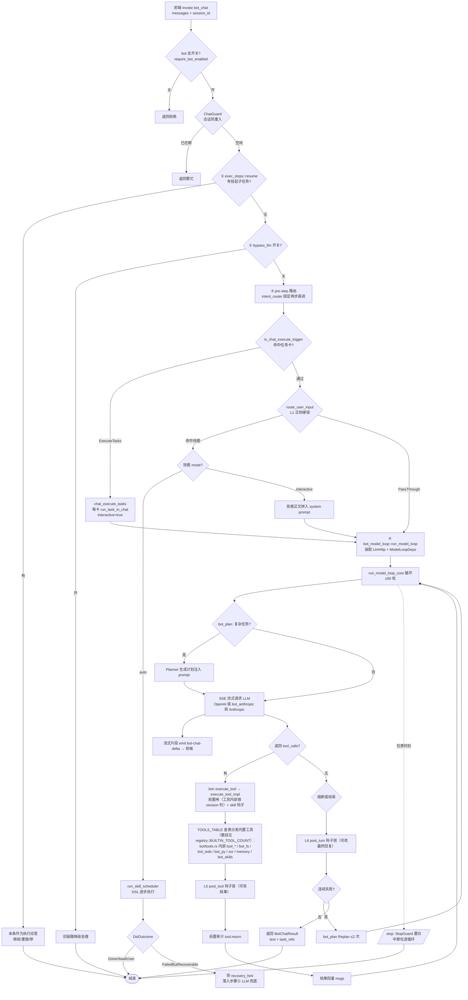
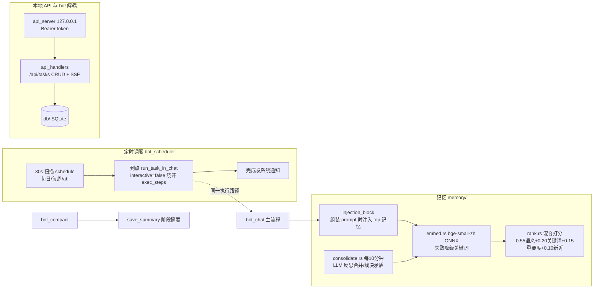
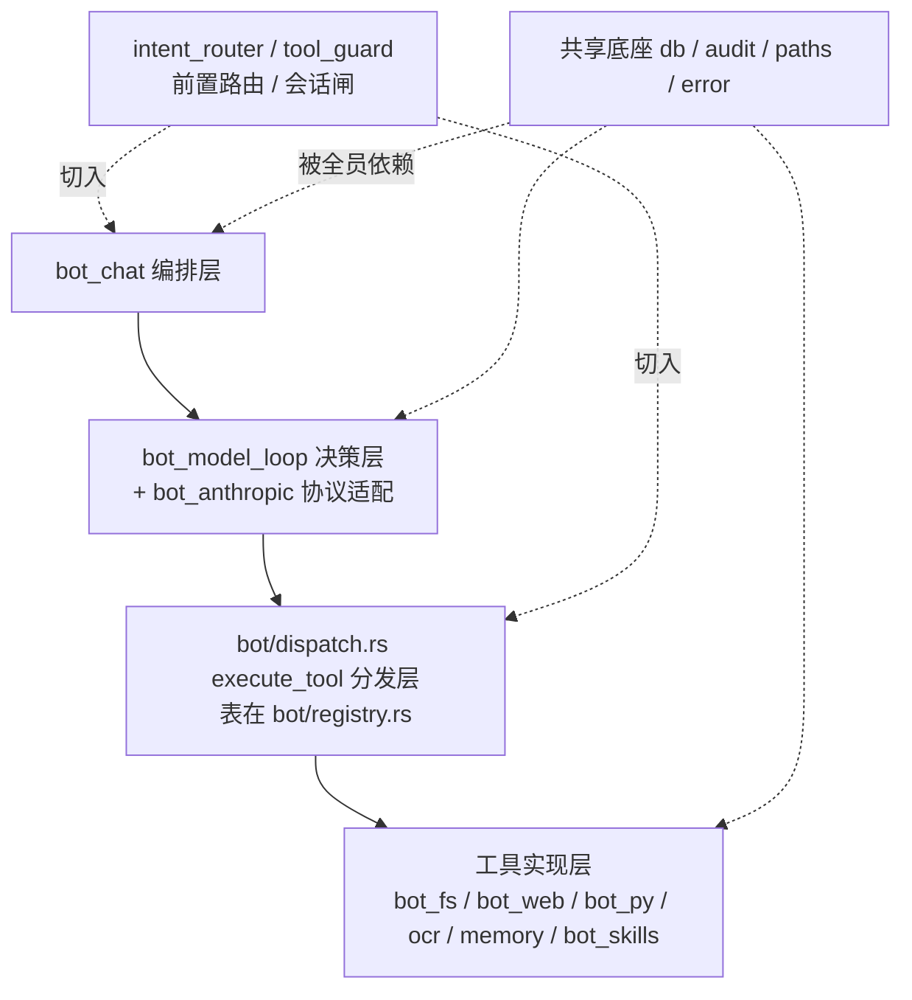

# wmessage Rust Bot 架构说明

> 项目形态：Tauri 2 桌面应用（任务看板 + AI 助手）。单 crate（`src-tauri/`，lib 名 `wmessage_lib`），`main.rs` 仅 6 行调 `wmessage_lib::run()`。Rust 业务源码共 313 个文件、约 13.6 万行，全在 `src-tauri/src/`；同 crate 里另有 `src-tauri/tests/` 10 个集成测试 target（16 个源文件——llm_integration 拆成目录形态 `tests/llm_integration/`）与 `examples/` 1 个。`src-tauri/vendor/tiny_http` 是 vendored 补丁依赖，非业务代码。

## 1. 文件结构 + 职责

```
src-tauri/src/
├── main.rs (6行)        入口，调 wmessage_lib::run()
├── lib.rs (1196)         模块总表、Tauri setup、invoke_handler 注册、托盘/快捷键、退出清理
│                        （setup 里另起清扫：上次被杀留下的 app_runs running 僵尸行）
├── app_state.rs (280)   运行期全局状态单一入口 `AppState`（lib.rs setup `app.manage` 注入）：
│                        14 张执行期表 + 「全局状态总表」文档；详见 §2.1
│                        （原 consts.rs 已并入 app_consts 命令、本节不列）
├── error.rs             CommandError 结构化错误（code=CommandErrorCode 枚举/message/recoverable），全命令统一
├── paths.rs             数据目录解析 + 便携模式判定
├── audit.rs             审计事件写 bot.log（audit_event! 宏、write_event、error_kv 带 code）
│   ├── audit/tests.rs   审计单测（日志写入 / 级别映射 / 错误分类 / panic 钩子）
│   ├── audit/error_class_tests.rs  错误文本→错误码分类单测
│   ├── audit/freeform_freeze.rs    free-form 审计入口冻结守卫（`audit_log(` 白名单）
│                        ——口径：生产切片 = 全文剔除全部 `#[cfg(test)]` 块，与代码
│                        位置无关；测试专用文件按 `#[cfg(test)] mod X;` 声明识别
├── profile.rs           个人资料：用户/机器人 头像 + 姓名（预设 ID 制：16 张内置头像全链路只传 ID，
│                        不再 base64 走 IPC；profile.json 原子写 + 损坏备份）
├── mutation.rs          任务变更来源枚举 MutationOrigin（Main/Bot/Api/Migration），tasks-updated 事件分流
├── llm_text.rs          LLM 输出文本小工具：strip_fences 剥 ```json 围栏
│                        （task_autotag / memory::extract / memory::consolidate 共用）
│
│─ 数据层
├── db/                  SQLite（wmessage.db）+ 迁移 + 产物 + 工作区（按表分文件）
│   ├── db/mod.rs      模块声明 + 公共 re-export + open_db / ensure_columns
│   ├── db/tests.rs + db/tests/{pragmas,legacy_wal,migrate_json,files,history,session,upsert}.rs
│   │                   db 层单测（PRAGMA / ensure_columns / legacy 拷贝 / 迁移 /
│   │                   任务文件 / bot_history / upsert 语义）——原内联在 mod.rs 尾部，
│   │                   拆分时逐字搬移；按主题切成七个子文件，门面只留共用辅助与
│   │                   mod 声明；仍是 db 的直接子模块，`super::` 语义不变
│   ├── db/ws_tests.rs  工作区（workspace / bind_files）单测
│   ├── db/reset_tests.rs  reset 命令单测
│   ├── db/atomic_write_tests.rs  原子写单测
│   ├── db/tasks.rs (979)  Task / Subtask / TaskFile；task_patch 写口校验截止与排期时间格式
│   │                     （截止只认 YYYY-MM-DD 与 YYYY-MM-DDTHH:mm，解析不了的一律拒）
│   ├── db/tasks_patch.rs (343)  task_patch / task_set_column 的锁内纯逻辑段（字段白名单应用器 +
│   │                     锁内读改写段）；与 db/tasks.rs **同层**，`super::` 语义不变
│   ├── db/tasks_transfer.rs (313) 导出/导入纯逻辑段（路径闸门 check_export_path + v2 信封组装 +
│   │                     导入事务 + bounded 读）；与 db/tasks.rs **同层**，`super::` 语义不变
│   ├── db/tasks/task_set_column_tests.rs (117)  列状态迁移单测
│   ├── db/tasks/task_patch_tests.rs (395)       定向补丁单测
│   ├── db/tasks/task_status_tests.rs (56)       TaskStatus 线格式单测
│   ├── db/tasks/owner_graph_tests.rs (346)       归属归一 + 导入导出信封单测
│   └── db/tasks/import_bounded_tests.rs (23)    导入文件 bounded 读单测
│   ├── bot_sessions.rs   BotSession / 会话归属
│   ├── bot_history.rs   会话聊天记录
│   ├── migrations.rs     数据库迁移（历史顶层 migration.rs 已并入）
│   ├── paths.rs          data_dir()/gen_dir()（AI_Gen_Files）
│   ├── skill_out.rs      技能产物输出
│   ├── subagents.rs      子 agent 编排持久化（SubagentRow / 六态状态机 transition_allowed /
│   │                     SubagentBudget 预算三硬顶；spawn 插 queued 行，check 幂等轮询）
│   ├── people.rs         成员注册表（多人任务汇总的归属人字典；people_list 命令 +
│   │                     upsert 最新名覆盖 + 占位兜底，见 docs/archive/TASK-GRAPH-DESIGN-2026-10-05.md §1）
│   ├── reminders.rs      机器人提醒（reminders 表）：到点发系统通知，不建卡不执行；
│   │                     定时串与作业同格式，触发点计算共用 bot_scheduler
│   ├── schedule_jobs.rs  内容型定时作业（T1）：XXL-JOB 式调度日志——重试/自动暂停/
│   │                     错过消费 + scheduled_job_runs 执行历史；定时单源本表
│   │                     （open_db 迁移把旧 tasks.schedule 迁入并清空任务卡侧）
│   ├── db/trace.rs (927)   执行痕迹三表 exec_traces/exec_spans/file_changes（Agent 透明化
│   │                     设计 §4.1）：append-only 观测面 + 钳制单源（SPAN_TEXT_MAX 16KB /
│   │                     MAX_DIFF_LINES）+ 保留期清理 retire_traces_before（僵尸 running 同删）；
│   │                     保留期边界（TRACE_RETENTION_MIN/MAX_DAYS）与词元统计可查窗口
│   │                     （USAGE_STATS_MAX_DAYS）各一份常量，命令与设置页公示共用
│   │                     痕迹表也是幻觉守卫的证据源：file_paths_with_receipt（某路径历史上
│   │                     有没有工具写过，按 path COLLATE NOCASE 走索引）/
│   │                     不可证伪写入通道（run_python / MCP 这类自己就能写盘、
│   │                     无从确证的工具）不再查库：让开口径从会话级改成提问级，
│   │                     判在模型循环侧（本次提问跑过就让开那一轮）/
│   │                     session_tool_names（本会话调用过 / 成功过的工具名，两档 →
│   │                     点名判据的排除集：跨提问的重述是真话；派过子 agent 的会话
│   │                     整档让开——子 agent 的 span 记在子 trace 下，join 不成立）
│   ├── db/trace_query.rs (221)   痕迹查询面：摘要列表 trace_query / 单条 trace_get_row +
│   │                     会话 span spans_for_trace + 会话工具名 session_tool_names
│   ├── db/trace_usage.rs (218)  词元统计聚合面：按日 / 按模型 / 按模型×按日三档
│   ├── db/trace_session.rs (417) 本会话文件改动面（聊天侧栏「文件」）：清单 / 详情 /
│   │                     累计 diff（累计口径 vs 逐次降级口径）
│   ├── db/trace/tests.rs (1263)  痕迹层单测（三表写入 / 保留期 / 词元统计 / 查询面）
│   ├── db/trace_session/session_file_changes_tests.rs (319) 本会话文件改动单测
│   ├── db/apps.rs        程序 apps 表 CRUD + app_runs 运行史 + app_versions 版本快照
│   │                     （滚动保留最近 100 版，见 docs/APPS-DESIGN-2026-10-15.md §5）
│   └── workspace.rs      workspace / bind_files
├── task_out.rs          对外 TaskOut（Task flatten + status），api/api_handlers 共享
├── trace_sink.rs        执行痕迹采集管道（Agent 透明化设计 §4.2）：dispatch 工具调用 →
│                        mpsc 后台攒批落库（writer 长连接 + DB_WRITE_LOCK）；trace 生命周期
│                        begin/end_trace（run_task_in_chat_with 首尾）+ TraceCapture 挂钩
├── task_autotag.rs      归档自动打标（一次性 LLM ≤3 标签回写 tags；守卫链幂等 +
│                        校验链截断不整包拒 + 失败静默审计，见任务图谱设计 §2）
├── tag_similar.rs       标签近义（embed 引擎逐标签向量 + 余弦 ≥0.78 对返回；
│                        进程级向量缓存 + 审计，图谱同义聚簇锚点用，任务图谱设计 §3）
│
│─ 模型元数据 meta/（原独立 Python 服务 model-meta-service 的内嵌版，127.0.0.1:8765 已退役）
├── meta/mod.rs          MetaProvider/MetaModel/MetaModelJoined + meta_provider/meta_model
│                        双表 CRUD（DDL 在 db/migrations.rs ensure_meta_tables，open_db 幂等建表）+
│                        8 个 meta_* 命令；user_custom 行永不被同步覆盖（ON CONFLICT WHERE 守卫）
└── meta/sync.rs         models.dev 同步：parse_models_dev 纯函数 + sync_models_dev
                         （shared_llm_client + 30s 超时；lib.rs setup 后台 spawn，失败仅审计不阻断）
│
│─ 本地 HTTP API（127.0.0.1 微服务，与 bot 解耦，只操作任务数据）
├── api.rs               trait TaskStore + MemStore(测试) + TauriStore(生产)
├── api_server.rs        HTTP server 生命周期、端口绑定、EventHub（SSE 中枢）
├── api_auth.rs          Bearer token（runtime/flags/api-token.txt）、开关持久化（runtime/flags/api-enabled.flag）；
│                        token 文件为空则原子覆写自愈（否则 create_new 恒撞 AlreadyExists，api_start 起不来）
├── api_handlers/        REST /api/tasks CRUD + SSE + api_start/stop 等命令
│   ├── api_handlers/mod.rs  模块声明 + 路由分发
│   ├── api_handlers/handlers.rs      HTTP 路由层
│   ├── api_handlers/commands.rs  tauri 命令层
│   ├── body.rs          请求/响应模型
│   ├── api_handlers/sse.rs  SSE 事件流
│   ├── ratelimit.rs     限流
│   ├── util.rs          工具函数
│   ├── validate.rs      入参校验
│   └── api_handlers/types.rs    共享类型
│
│─ Bot 核心（编排 → 决策 → 工具分发）
├── bot_chat.rs (429)    入口编排门面：bot_chat / bot_compact / bot_execute_task 命令 + 公共类型
│                        （ChatMsg/TaskRef/BotChatResult）+ 子模块转出（旧路径 1:1 保持）
│   ├── bot_chat/flow.rs (730)   聊天主流程：bot_chat_inner 主体 + 技能路由 + ChatGuard 防重入
│   ├── bot_chat/exec.rs (563)   任务执行面：批量执行 + ExecGuard + run_task_in_chat 全链路
│   ├── bot_chat/media.rs (152)  多模态图片组装：base64 入模 + 扩展名白名单 + 附件索引
│   ├── bot_chat/summary.rs (327) 历史摘要面：截断点选择 + 摘要请求 + 压缩
│   ├── bot_chat/inject.rs (96)  上下文注入面：摘要/记忆块并入末条消息（保缓存前缀稳定）
│   ├── bot_chat/report.rs (154) 子任务汇报轮：回传结果 + 门控 + 历史映射
│   ├── bot_chat/input.rs (110)  输入规范化面：不可见字符清洗 + 路由前判定 + 恢复提示
│   ├── bot_chat/bot_chat_pure_helpers_tests.rs (716) 纯函数与接线守卫单测
│   ├── bot_chat/inject_tests.rs (139)                 注入面单测（注入位置 + 前缀稳定性）
│   ├── bot_chat/image_attach_tests.rs (73)             图片附件单测
│   ├── bot_chat/command_error_mapping_tests.rs (33)    命令错误映射单测
│   └── bot_chat/chat_exec_guard_tests.rs (55)          ChatGuard / ExecGuard 语义单测
│─ 提示词 prompts/（AI 应用的业务逻辑，与代码同等对待；统一从 `crate::prompts::NAME` 取）
├── prompts/mod.rs        模块声明 + `crate::prompts::NAME` 统一出口 + prompt 清单锁测试
│   ├── prompts/subagent.rs 子 Agent 编排提示词（设计 §8）：主 agent 派发职责段/
│   │                     子 agent 通用段/research·coder·general 三 profile/收尾
│   │                     JSON schema 提示；镜像资产 docs/prompts/subagent/
│   prompts/system.rs       SYSTEM_PROMPT（主聊天规则底座 + 安全红线）
│   prompts/summary.rs      SUMMARY_SYSTEM_PROMPT（截断即摘要 ≤200 字）/ COMPACT_SYSTEM_PROMPT（/compact ≤300 字）
│   prompts/execute.rs      EXECUTE_SYSTEM_PROMPT（任务卡执行）/ STEPWISE_ADDENDUM（逐步执行附加段）
│   prompts/planner.rs      PLANNER_PROMPT / REPLANNER_PROMPT（bot_plan 动态计划，只输出 JSON）
│   prompts/consolidate.rs  CONSOLIDATE_PROMPT（记忆整理，只输出 JSON ops）
│   prompts/extract.rs      EXTRACT_PROMPT（U16 会话收尾记忆抽取，只输出 JSON 数组）
├── bot_model_loop.rs (120) LLM 流式调用+工具循环的**门面**：只留 mod 声明 + re-export
│                        （旧路径 `crate::bot_model_loop::X` 1:1 保持）；实现全在
│                        bot_model_loop/ 子模块
├── bot_model_loop/        模型循环子模块（按职责拆分；门面作唯一枢纽，子模块间零直接依赖）：
│                        **墙钟治理**（WallBudget：软墙钟收尾提醒 + 墙钟熔断留产，均在轮边界检查）
│                        在 types.rs + fuse.rs；LlmHttp / ModelLoopDeps 依赖注入在 types.rs；
│                        llm.usage 薄壳累计 + bot-usage-delta 水位条事件在 shell.rs
│                        （TOOLS schema 已移出，见 bot/registry.rs）
│   ├── bot_model_loop/stream.rs (436)   SSE 解析层：parse_sse_chunk / feed_think（思考块拆分）/
│   │                                    tool_call 增量累积 / token usage 归一
│   ├── bot_model_loop/core.rs (1076)     核心循环：run_model_loop_core（可注入 mock）+
│   │                                    dispatch_round（工具分发/回灌）
│   ├── bot_model_loop/shell.rs (536)    薄壳装配层：run_model_loop（构造 LlmHttp + ModelLoopDeps）
│   ├── bot_model_loop/request.rs (723)  请求装配层：请求体构造 / 429·超限重试 / 轮前准备与压缩
│   ├── bot_model_loop/sse.rs (749)      SSE 流消费层：逐 chunk 读取 / 空闲超时 / 流内错误
│   ├── bot_model_loop/guard.rs (707)    防幻觉守卫层：终稿声称与实际动作对账（guard_collect/
│   │                                    guard_verdict）+ 自检回复判定 + 工具自检侧调路由
│   ├── bot_model_loop/finalize.rs (366) 收尾层：无工具收尾 / 自检侧调（decide_selfcheck）/ 出口闸
│   ├── bot_model_loop/fuse.rs (215)     熔断层：单轮 Function 调用上限 / 轮数·墙钟熔断 / 软警告注入
│   ├── bot_model_loop/types.rs (366)    共享类型：ModelLoopDeps / 请求状态机 / 流结构 / 数据类
│   ├── bot_model_loop/output.rs (172)   工具结果回灌体积漏斗：per-tool 预算与全局 cap 取小、
│   │                                    超限转存溢出文件 + 只回灌节选与指针
│   ├── bot_model_loop/context.rs (255)  上下文瘦身层：超限判定 / 历史裁剪 / 索引重排修正 /
│   │                                    轮内工具结果滑动窗 / 用户意图抽取
│   ├── bot_model_loop/evidence.rs (94)  证据来源层：从消息抽文本·来源，数字是否可溯源
│   ├── bot_model_loop/tests.rs (74)     单元测试六桶的入口 + prod_src() 生产代码全景扫描源
│   ├── bot_model_loop/tests/guard.rs (1024)   幻觉守卫 / 熔断 / 接线类测试
│   ├── bot_model_loop/tests/parse.rs (596)   SSE 解析 / 增量累积 / schema 测试
│   ├── bot_model_loop/tests/config.rs (616) 推理参数 / 思考 / 上下文超限 / 侧调门测试
│   ├── bot_model_loop/tests/tool_window.rs (234) 轮内工具结果滑动窗测试（裁剪口径 / 护栏 / 桩子）
│   ├── bot_model_loop/tests/fail_hint.rs (58)   工具失败「换策略」提示按工具分流的单测
│   ├── bot_model_loop/tests/intent.rs (113)  侧调自检测试（路由阈值两态 / 用户意图抽取）
│   ├── bot_model_loop/tests/sse.rs (157)    读流层测试（叫停后不推流 / 正文照旧记账）
├── bot.rs (213)         bot 族唯一对外门面：跨族 re-export（BotChatResult/TaskRef/ChatMsg/
│                        model_loop/StopGuard/StopToken/AuditLevel/db::* 等）+ 子模块声明；
│                        **跨族引用一律走 `crate::bot::`**，族外不得直接摸
│                        `crate::bot_chat::` 这类深层路径（tests-audit/audit_bot_namespace.py
│                        守卫，族内互引豁免）
├── bot/params.rs        Agent 运行参数注册表（P3-a）：PARAMS_TABLE 单源（可编辑 config 驱动 +
│                        硬编码只读两区）+ resolve_* 读取口唯一（max_rounds/history_budget/
│                        subagent 预算/search 条数）+ bot_effective_params 命令；settings 页参数卡同源
│                        （默认值 = resolver 在空配置下的派生值；可填范围 = 钳制常量 min/max；
│                        生效值 = 钳过之后的数 + 来源标注——页面不再自留一份硬编码数字）。
│                        **三档任务模式**（light/balanced/deep）在此：每档一次性给六个预算的
│                        预设值（全局回合池 / 工具调用 / 墙钟 / 历史预算 / 输出上限 / 回填上限），
│                        分配比例主会话 60% / 单个子 agent 20% / 单个技能 15% 内置不可配；
│                        逐项高级覆盖优先于档位。测试在 bot/params/tests.rs。
├── bot/constants.rs     Agent 风控工程常量（开发者维护，设置页不暴露）：上下文/IO 闸、
│                        熔断阶梯（90% 软告警 / 95% 收尾窗 / 100% 硬熔断）、流程风控常量、
│                        技能配额、子 agent 并发——改风控策略只改这一处。
│                        只读行不作为设置项露出，但**可被设置页文案引用**（值从表里取）：
│                        如 trace.retention_days 的可填范围、memory.extract_min_interval_secs
│                        的抽取限频——文案里的数不留手写副本
├── bot/registry.rs (221)  **工具单源真相（阶段 2）** 的门面：类型（ToolCtx / ToolStatus /
│                        ToolResult / ToolDef）+ 逐项 re-export——实现按面拆到下面三个子模块，
│                        `crate::bot::registry::X` 旧路径与旧可见性保持不变
│   ├── bot/registry/schemas.rs (1203)  65 个 SCHEMA_* 字面量 + TOOLS_TABLE（name/schema/mutating/call，
│   │                        数目以 BUILTIN_TOOL_COUNT 为准，子 agent 专属工具见 SUBAGENT_ONLY_TOOLS）→
│   │                        TOOLS JSON（tools_json）/ MUTATING_TOOLS / dispatch 查表三处全派生
│   ├── bot/registry/handlers.rs (437)   65 个 call_* 一行转发（ToolCtx + args → 工具实现）
│   ├── bot/registry/claims.rs (792)     声明判据面：模型「声称做了」的提取与判定
│   │                        （变更声称 / 执行声称 / 数值 / 文档路径 / 工具点名）
│   ├── bot/registry/mentioned_tool_names_tests.rs (77)  工具点名整词匹配单测
│   ├── bot/registry/claimed_executed_tools_tests.rs (63) 执行声称单测
│   ├── bot/registry/result_claim_tests.rs (98)  结果值抽取与回声判定单测
│   └── bot/registry/registry_tests.rs (1146)  工具表基线守卫（表长 / 条目顺序 / schema 字面量 /
│                        profile 白名单 / tools JSON 形状）+ TOOLS_TABLE 无 cfg-gated 条目守卫
├── bot/dispatch.rs (1062)  工具调度核心 execute_tool / execute_tool_impl：**TOOLS_TABLE 查表**（非 match）+
│                        pre_execute 洋葱入口 + skill_on_step 钩子 + tool.return 结构化审计 +
│                        子 agent 软墙钟闸（剩余预算进入收尾窗口即拒绝新调用，不打断在飞工具）
│   ├── bot/dispatch/commit_and_report_tests.rs (73)   写库失败口径单测：status 与文本同答案 +
│   │                        fail_prefix 可被 classify_tool_failure 认出（7 处任务卡工具）
│   ├── bot/dispatch/early_return_events_tests.rs (109) 早退事件序列单测：规则闸 deny 与 skill
│   │                        熔断两条路径的 tool.return 配平 + trace 键集
│   ├── bot/dispatch/invalid_args_tests.rs (95)        入参 JSON 闸单测：空参/非对象 JSON 放行、
│   │                        坏 JSON 拒绝并回可解释文案 + 闸位接线守卫（源码文本）
│   ├── bot/dispatch/pre_tool_hook_tests.rs (535)      pre_tool 钩子接线守卫（语句存在 + 三点相对位置）+
│                        panic 隔离守卫 + 收尾窗放行清单漂移 + 门禁早退 Denied 口径（10 处）
│   └── bot/dispatch/allowed_tools_tests.rs (109)      allowed-tools 交互路径闸：集合内外/未声明/跨会话
│                        判定单测（mock handle + 真注册表）+ 接线守卫（闸在规则表之前）
├── bot/hooks.rs           L4 pre_tool 钩子扩展点（design ONION-HOOKS-DESIGN-2026-10-16 §四）：
│                        HookRegistry 进程级注册（OnceLock 单例，同层内按注册序；层序只由
│                        dispatch 调用栈保证，注册表无任何层序配置入口）+ HookLayer 会话级禁用 +
│                        ToolCallView 只读视图（字段全是共享借用，L4 无法改写入参）+ 内置观察钩子
│                        （builtin_observer，计数 + bot.log 留痕）。接线点唯一：
│                        dispatch.rs::run_pre_tool_layer（三道闸之前）
├── bot/eval.rs           提示词评估层（cfg(test) 手动评估器，不进门禁）：真模型 × 生产
│                        SYSTEM_PROMPT+MAIN_AGENT_ADDENDUM × 记录型 stub 工具，12 条纪律
│                        用例（参数被拒不降级/拒绝不重试/失败不谎报/产物带路径/来源引用/
│                        记忆纪律/小任务不派子 agent/溢出指针读回/格式重试/熔断如实收尾）；
│                        配置快照 src-tauri/eval-bot-config.json（gitignore）+ key 走 keyring
├── bot/mcp/             外部 MCP 服务器接入（stdio/HTTP，设置页 McpPanel 管理）：
│   ├── bot/mcp/mod.rs   模块声明
│   ├── bot/mcp/config.rs        McpServerConfig/校验（stdio 启动器白名单、URL 公网闸、
│   │                            normalize/timeout 钳制）+ 工具命名 mcp_tool_name/tool_prefix
│   ├── bot/mcp/manager.rs       McpManager（OnceLock 单例）：**按需启停**（静默待命 /
│   │                            调用期拉起 / 调用完回收；ensure_connected/call_tool/retire）、
│   │                            指纹懒重连、stderr 环形缓冲、spawn 白名单字面量构造、
│   │                            子进程资源采样（5s TTL 缓存，口径同 bot/procs：
│   │                            RSS / CPU / 监听 socket，整棵进程树合计）
│   ├── bot/mcp/manager/send_probe.rs        Send/Sync 断言 + stdio 允许清单与 spawn 构造一致性
│   ├── bot/mcp/manager/fingerprint_tests.rs  配置指纹稳定性（含 env/headers 变化换指纹）
│   ├── bot/mcp/manager/http_gate.rs         HTTP 分支两道闸单测（字面量闸 + DNS 闸 + 钉 IP）
│   ├── bot/mcp/manager/e2e_stdio.rs         stdio 真进程端到端（连接/发现/调用/回收/长行截断）
│   ├── bot/mcp/tool_cache.rs    工具清单磁盘快照（mcp-tool-cache.json）：按服务器 id 存
│   │                            「配置指纹 + 工具清单」——按需启停下「工具可见性」与
│   │                            「活连接」解耦的载体（没有它，模型看不见未连接的服务器）
│   ├── bot/mcp/mount.rs         挂载层：连接快照 → 工具 schema 段（撞名消歧/条数/schema 体积
│   │                            上限）+ dispatch miss 反查 execute_mcp_tool（带超时/结果整形）；
│   │                            函数名走进程级登记簿（名字 ↔ 服务器跨断连稳定，不随重连漂移）；
│   │                            外部工具结果超限（MAX_RESULT_BYTES 30K）同发
│   │                            tool.output.over_budget（server 字段区分来源）——超长输出必须
│   │                            留痕；但外部工具**不进**幻觉守卫（claims_mutation 只从内置
│   │                            注册表派生，外部落盘行为宿主不可知，无从给判据）
│   ├── bot/mcp/secrets.rs       B4-6 机密存储：env/headers blob 走 keyring `mcp:<id>` 条目
│   │                            （Linux 降级单文件 0600）+ 进程内缓存 + load_config 水合 +
│   │                            迁移判据；配置永不明文（skip_serializing 收口）
│   ├── bot/mcp/commands.rs      设置页 tauri 命令：mcp_server_save/delete/toggle、
│   │                            mcp_status（回 builtin 标志 + 子进程 pid/内存/CPU/运行时长/
│   │                            监听 socket）、mcp_server_tools（写路径 CONFIG_WRITE_LOCK 全程持锁；
│   │                            内置条目 delete 拦截）
│   ├── bot/mcp/stdio_transport.rs  stdio 子进程传输（读侧行长上限 + 子进程生命周期托管）：
│   │                            LineCappedReader 每行最多转发 1MB（超出的丢弃，rmcp 的
│   │                            read_until 无上限 → 外部服务器一条长行就能撑爆宿主）；
│   │                            CappedChildProcess 托管子进程（关 stdin → 3s 优雅退出 →
│   │                            超时强杀），不依赖 rmcp 的 TokioChildProcess
│   └── bot/mcp/builtin.rs       内置条目（Playwright 浏览器）：playwright-mcp/ 包目录解析
│                                （env → exe 同目录 → 资源目录 → 仓库根）+ Chromium 内核定位
│                                + 启动时缺失才补写配置（默认停用）
├── bot/procs.rs (1202)      进程树公共模块（受管服务层与 MCP stdio 共用）：
│                        纯进程操作，不碰任何上层登记表——只依赖 pid 空间与系统进程表：
│                        进程快照（pid/ppid/启动标识/RSS/CPU 时间，Linux 读 /proc、
│                        macOS 调 ps）+ ppid 树子孙收集 + 增量比对（PID 复用识别）
│                        + 停止阶梯 stop_tree（SIGINT→100ms→SIGTERM→400ms→SIGKILL，
│                        每级发信号前拍一张快照增量收集子孙，最后统一杀）
│                        + CPU 占用率公式 cpu_usage_pct（两个上层共用一条）
│                        + 监听 socket 枚举 listening_sockets（Linux 读 /proc/<pid>/fd
│                        的 inode 配 /proc/net/tcp{,6}、udp{,6}；macOS 走 lsof；
│                        **Windows 没有**——现有进程快照层在 Windows 上本就退化）
│                        + 平台能力声明 listening_supported（Windows 为 false——
│                        判定层据此返回 Unsupported 而非 Ok）
│   └── bot/procs/tests.rs (599)  进程树纯函数单测：快照解析 / 树收集 / PID 复用 /
│                        整组杀护栏 / 资源采样 / socket 解析（/proc/net 与 lsof 两套格式）
│                        + 真子进程监听端口集成测试（验平台路径真能读到）
│                        + 控制台程序静默标志守卫（扫 src/ 全树的生产切片）
├── bot/test_files.rs (147) 源码结构识别（两个扫源码的门禁共用）：测试专用文件按
│                        `#[cfg(test)] mod X;` 声明识别 + 生产切片剔除内联
│                        `#[cfg(test)]` 块。判据不看文件名也不看代码位置——
│                        位置启发式会把「测试块在前、生产代码在后」的文件整段漏扫
├── bot/services.rs (489) 受管长驻服务层（宿主托管的长驻进程：node MCP server / dev server / watcher）：
│                        **门面**——实现按面拆到下面六个子模块，这里只留类型 / 常量 / use /
│                        逐项转出（`crate::bot::services::X` 旧路径与旧可见性保持不变）
│                        登记表（AppState.services）+ 状态机（Starting/Running/Stopping/Exited/Failed）
│                        + 宿主直接 spawn（不继承 run_python 的 rlimit）+ stdout/stderr 落 O_APPEND 文件
│                        + 停止信号阶梯（SIGINT→100ms→SIGTERM→400ms→SIGKILL）+ ppid 树子孙回收
│                        （带 starttime 防 PID 复用）+ 资源观测（整棵进程树 RSS / CPU，
│                        只告警不杀）。与 py/runtime.rs 是两层：前者有界作业、
│                        连坐杀组；本层长驻、宿主知道它、能停它、退出时收干净
│                        + 服务告警进通知中心（资源告警 / 端口违规，条件消失自动撤收）
│   ├── bot/services/gate.rs (681)  端口/监听地址闸（P2-③）：判据 L1 默认只许 loopback
│   │                        （放开靠独立开关）/ L2 禁占宿主保留端口 / L3 禁特权端口；
│   │                        判定三态 Ok / Violated / **Unsupported**（Windows 没判≠没事）；
│   │                        **采集金丝雀**：API server 开着时宿主必在监听 API_PORT——
│   │                        采样自称成功却看不见它 = 采集失明（lsof 权限不足一类），
│   │                        与采集失败同路处理（不判/保留集不动）+ 转折审计
│   │                        service.listening_canary_failed；API 没开时无基准不判
│   │                        （不制造误报源）；
│   │                        违规记在**正交字段** last_violation（不复用状态机）+
│   │                        审计 service.port_violation + 面板红色徽章 + 通知中心一条；
│   │                        启动期加密采样（0/0.5/1/2/5/10s）+ 30s 巡检，发现即终止
│   ├── bot/services/logs.rs (189)  日志与输出上限面：服务日志目录 / append 写 /
│   │                        尾部读（字节与行两种口径）+ 截断到 OUTPUT_CAP_BYTES +
│   │                        每 30s 一轮的输出上限巡检
│   ├── bot/services/observe.rs (282) 资源观测面：合计口径判定（阈值 / 持续 / 去重）+
│   │                        采样一轮（整棵进程树 RSS / CPU）+ 告警落审计 + 系统通知
│   ├── bot/services/serialize.rs (114) 序列化面：服务条目 → JSON（给模型看）+
│   │                        受管服务全景快照（合计 RSS / 合计告警 / 本平台能否采样；
│   │                        采不到时给 null 而不是 0——「没判」不是「没占用」）
│   ├── bot/services/start.rs (523) 启动面：白名单逐臂构造（源码层不存在「变量 → 进程名」
│   │                        的路径）+ 登记表占位（查与占在同一把锁里完成）+
│   │                        就绪等待（stdout 匹配正则 / 无 pattern 时的短存活确认）+
│   │                        就绪失败归因（端口违规 > 非法正则 > 进程自己退 > 等超时；
│   │                        退出码取**停止前**的快照——停了之后读到的都是我们 kill 的那个）
│   ├── bot/services/stop.rs (257) 停止面：降级信号阶梯（SIGINT → SIGTERM → SIGKILL）+
│   │                        脱离进程组的子孙回收（带 starttime 防 PID 复用）+
│   │                        退出确认（停不掉就报失败并把状态放回原样，不写 Exited——
│   │                        写了等于把它从退出清理里摘掉，而它还在跑）
│   ├── bot/services/watchdog.rs (295)  服务层「宿主死了服务也得死」看门狗：
│   │                            unix 用管道 EOF（宿主一死 → 写端关闭 → 助手 TERM 服务整组）；
│   │                            Windows 复用 py/runtime.rs 的 Job Object（KILL_ON_JOB_CLOSE）
│   ├── bot/services/tests.rs (62)    服务层单测的**门面**：按主题拆到下面七个测试子文件，
│   │                        这里只留共用辅助（找一个能长驻的启动器）与 mod 声明
│   ├── bot/services/tests/adjudicate.rs (168) 就绪失败的归因（先判后停）：退出码取停止前的快照、
│   │                        端口违规文案压过超时、非法 readyPattern 不报成超时、
│   │                        审计行分得清「我们杀的」与「它自己退的」
│   ├── bot/services/tests/canary.rs (291) 采集金丝雀：采样自称成功却看不见宿主必在监听的端口
│   │                        = 采集失明；盲 / 空的区分、转折审计、巡检先过金丝雀再进判定
│   ├── bot/services/tests/integration.rs (329) 集成用例：真起一个受管服务、真停它、
│   │                        setsid 逃逸子孙回收、不继承 run_python 的 rlimit
│   ├── bot/services/tests/logs.rs (72) 日志截断：截断后保尾、低于上限不动、
│   │                        append 续写不留空洞
│   ├── bot/services/tests/observe.rs (385) 资源观测：合计口径判定（阈值 / 持续 / 去重）+
│   │                        采样一轮、告警落审计与通知中心、采不到 ≠ 没占用
│   ├── bot/services/tests/port_gate.rs (173) 端口 / 监听地址闸：flag 解析、loopback 判定、
│   │                        L1-L3 判据、动态保留集
│   └── bot/services/tests/state.rs (45) 启动白名单与状态机：白名单逐臂构造 +
│   │                        只有活着的状态算占名额
├── bot/config/          BotConfig/ApiProvider/PermMode/KeySlot（bot-config.json，key 走系统 keyring）；
│   ├── bot/config/mod.rs  模块声明
│   ├── bot/config/schema.rs        bot-config.json schemaVersion 迁移 + 双协议派生
│   │                               （derive_legacy_fields_from_active / active_model_entry
│   │                               / effective_inference 条目级推理参数解析）+ resolve_max_tokens
│   ├── bot/config/types.rs  ApiProvider / PermMode / KeySlot
│   ├── bot/config/io.rs    配置读写 + 默认值 + read_memory_control（U15 记忆开关轻量读取）
│   ├── keyring.rs        API key 走系统 keyring
│   ├── bot/config/commands.rs  bot_get_config / bot_set_config
│   ├── bot/reasoning.rs  推理强度线上参数映射（RE-1）：EffortLevel 档位 →
│   │                     按模型族/协议的 ReasoningWire（OpenAI effort/GLM thinking/
│   │                     Anthropic budget），resolve 装配 + describe 审计展示
│   └── audit.rs         audit_log
├── bot/tools.rs (96)      工具实现门面：23 个 tool_* 逐项转出（crate::bot::tools::X 旧路径 1:1 保持）
│   ├── bot/tools/task.rs (1111)   任务面：查询族（view/过滤/渲染/query）+ 管理族（增删改/子任务/绑文件）
│   ├── bot/tools/doc.rs (836)     文档面：提取文档 / Word·Excel·PPT·PDF 生成 / 联网搜索 / 抓页 / 自由 Python
│   ├── bot/tools/service.rs (277) 受管服务面：start/stop/list 长驻进程 + 集成测试钩子
│   ├── bot/tools/common.rs (153)  公共杂项面：时间工具 / files 参数解析与安全校验 / 审计补充 kv / 改库广播
│   ├── bot/tools/trace.rs (231)    凭证召回面：按 tool_call_id/span_id/trace_id 调回历史工具结果（只读、零新表）
│   ├── bot/tools/plan.rs (155)      计划面：update_plan 整表替换写会话内计划状态 + 广播 bot-plan 事件
│   ├── bot/tools/task_files_arg_tests.rs (181)     files 参数解析与安全校验单测
│   ├── bot/tools/query_tasks_tests.rs (154)        查询族纯函数单测
│   ├── bot/tools/n3_toolpolish_tests.rs (79)       N3 工具升级纯函数单测
│   ├── bot/tools/tool_extract_document_tests.rs (64) 文档提取输出格式化单测
│   ├── bot/tools/tool_web_search_arg_tests.rs (45) 搜索 count 钳制单测
│   ├── bot/tools/sync_syscall_off_runtime_tests.rs (49) 同步 syscall 不得裸跑的源码守卫
│   ├── bot/tools/tool_due_format_tests.rs (35)      due 参数闸单测
│   ├── bot/tools/phase4_facts_tests.rs (24)         时间/事实类单测
│   ├── bot/tools/trace_tests.rs (251)             凭证召回工具单测（查回一致/查不到/只读无副作用）
│   ├── bot/tools/tool_run_python_tests.rs (55)   run_python 代码来源 / 退出码判定纯函数单测
│   ├── bot/tools/background_dialog_tests.rs (24)    后台执行不得弹框的源码守卫
├── bot/plan_state.rs (308)  Agent 计划状态（会话内 transient）：update_plan 的参数校验与状态存取
│                        （整表替换、三态 pending/in_progress/completed、至多一条 in_progress）→
│                        进程内会话表 → bot-plan 事件；bot_plan_state 命令给面板取当前快照
├── bot/stream_log.rs (484) 会话级流式事件的统一出口 emit_recorded：**盖信封**（载荷顶层的
│                        sessionId 由本函数统一注入，调用方不许自带同名键——盖章权分散到
│                        各发射点时漏一处就静默丢事件）→ 分配序号（会话内跨轮次连续，
│                        客户端据此去重）→ 写会话回放缓冲（2 万条 / 8MB 双上限，
│                        收尾后保留 120s 惰性清扫，游标老于窗口如实报 truncated）
│                        → 广播；在途登记 begin/finish 挂在模型循环装配层（core 返回即回合结束）；
│                        客户端不在场时靠 bot_inflight_list / bot_stream_replay 按 seq 补齐
├── bot_anthropic.rs     Anthropic 协议适配（纯函数）：OpenAI ↔ /v1/messages 双向转换、auth 头、prompt caching
├── bot_anthropic/tests.rs  协议转换单测（body 构造 / 工具槽位映射 / 思考块 / SSE 事件解析）
├── bot_plan.rs          PREVR 动态规划：复杂任务先生成计划注入 prompt，失败 Replan（≤2 次）
├── bot_scheduler.rs     定时任务卡调度：30s 扫描 schedule（每日/每周/at:），到点走 run_task_in_chat 自动执行；
│                        SchedGuard 防重入；完成发系统通知；
│                        机器人总开关关着时到点的作业判 Held（不派发、水位不推进，
│                        恢复后仍在补跑窗口内）——否则每 30s 空转一轮、每天几千条跳过审计
├── bot_scheduler/sched_tests.rs        调度主逻辑单测（occurrence / 触发 / 作业执行 / 收尾）
├── bot_scheduler/sched_guard_tests.rs   SchedGuard 防重入单测
├── bot_scheduler/plan_window_tests.rs   计划窗口单测
├── bot_reminders.rs (562) 机器人提醒 schedule_reminder/list_reminders/cancel_reminder：
│                        到点发系统通知（只说话，不建卡不执行内容）；when 支持绝对时间 /
│                        今天 HH:MM / 相对 +30m；repeat none/daily/weekly/monthly；
│                        定时串与触发点计算复用 bot_scheduler（occurrence_after），
│                        存储与触发路径独立（reminders 表）；与作业同一个 30s tick
├── due_notify.rs        任务卡截止系统通知：30s 扫描活跃任务（仿 bot_scheduler），截止前 1h 一条、
│                        截止时刻一条（超 24h 老任务不补发，防升级/重启后轰炸）；通知失败只记日志
├── bot_slash.rs         StopGuard/StopRegistry（/stop 按执行实例隔离；注册表已迁 app_state::AppState，
│                        见 §2.1）、危险操作确认弹窗、机器人总开关
├── exec_steps.rs        任务卡逐步执行模式：多子任务逐个做、用户确认「继续/重做/停」
├── bot/subagent_digest.rs (580) 子 agent 摘要与验收判据：build_subagent_digest / subagent_digest_block（父会话注入段）
│                        / mark_digested（已消化记账）+ 机器判据（file_exists / file_nonempty
│                        走服务端核验，不与模型自报的 met 混算）+ 父会话回报门控
├── bot/subagent_repair.rs (502) 收尾 JSON 的本地修复与结果判定：结构化输出三段修复的第二段（尾逗号 / 截断闭合，
│                        零 token 零延迟）+ parse_final_json + classify_outcome
├── bot/subagent_runner.rs (1067) 子 agent 执行体：run_subagent（建会话 → 工具循环 → 收尾落库）+ 取消 watcher
│                        + 墙钟硬停 + 任务包装渲染
├── bot/subagent_spawn.rs (466) 子 agent 派发：入参校验 / 预算钳制 / 建行 / 并发闸 SubagentGate（per-session 2 /
│                        global 3，闸满排队）
├── bot/subagent_tools.rs (414) 子 agent 的五个 LLM 工具：tool_spawn_subagent / tool_check_subagent /
│                        tool_cancel_subagent / tool_write_artifact_file / tool_read_own_card
├── bot_orchestrator.rs (692) 子 Agent 编排器门面（方案 B，SUBA 设计 2026-09-27）：类型与生命周期
│                        核心 + 子模块 re-export；受管子 agent 的
│                        spawn/check/cancel 生命周期状态机 + 无任务卡（子 agent 不再建卡，行上
│                        只存 parent_session_id 指向派发会话，遗留可空 task_id 不再写入）+ acceptance
│                        落行上 acceptance_json + 预算钳制；与 bot_execute_task（单发子 agent）入口/存储/事件
│                        各自独立；LLM 工具暴露/runner（SUBA-2）与预算强制/并发排队（SUBA-3）
│                        按设计 §11 分批接入；P4：spawn 预算默认走 bot/params 配置；
│                        **收尾契约**（2026-10-23）：预算单一钳制入口 + 收尾 JSON 三段修复
│                        （本地修复 + 补答一次）+ digest 补渲染（残留产出 / 机检未过项）+
│                        机器可判定条目的派发期形状校验
│                        采样接线（run_task_in_chat 闭包喂 maybe_record_trace）
│   └── orchestrator_tests/  编排器测试模块（门面只留生产码，测试按职责拆三份）
│       ├── orchestrator_tests.rs (114) 共享夹具：orch_prod_src（源码全景）/ test_conn /
│       │                          parent_card / fake_state / digest_row / req / OK_RESULT
│       ├── orchestrator_tests/lifecycle.rs (519) 生命周期与接线守卫：panic 隔离 / 收尾事件唤醒 /
│       │                          wait 策略 / 摘要注入位置
│       ├── orchestrator_tests/outcome.rs (679) 收尾契约与摘要：机器判据 / digest 幂等 / 汇报轮顺序 /
│       │                          包装渲染
│       └── orchestrator_tests/spawn.rs (1037) 派发与并发闸：建行 / 预算钳制 / 幂等 / 队列位次
├── bot_artifacts.rs     产物登记：link_file_to_task → 收尾按 TaskExecOrigin 分流 →
│                        落「通知中心」artifact_bind 消息（原 artifact-batch-ready 挂件弹窗已下线）→
│                        通知页勾选 → confirm_artifact_batch 落库 + notif_resolve_artifact 回写
├── notifications.rs (703) Agent 通知中心：notifications 表持久化消息（INSERT OR IGNORE 幂等，
│                        memory_proposal / artifact_bind / task_question 三类决策事件 +
│                        service_alert 一类服务告警——只告知不决策，条件消失时按
│                        (serviceId, alertType, warning) 三元组自动撤收）+
│                        notifications_list/pending_count/resolve/clear_done 四命令 +
│                        notifications-changed 广播；双向同步（mem approve/reject、
│                        confirm_artifact_batch 尾部回写消息状态）
├── bot_ui.rs (1177) 桌面 UI 自动化工具层（六件套）：list_windows / activate_window /
│                        ui_inspect / ui_click / ui_type / wait_for_element。
│                        四道闸——独立总开关（ui::ui_enabled，默认关闭）/ 窗口级授权
│                        （动作必带 windowId 且窗口真实存在）/ 危险动作确认
│                        （发送、提交、支付、删除类点击前弹窗，60s 无响应默认拒绝；
│                        判不出的（无标题按钮）一律确认）/ 敏感控件禁打（密码、验证码类不代填）；
│                        闸门与实际动作之间还夹两道——窗口身份（pid+标题）比对，
│                        变了就不动；控件身份（NodeIdentity）比对，对不上就不动；
│                        注入全程持全局互斥；每次动作留审计 +
│                        动作前后各一张截图（落 AI_Gen_Files）
├── ui/                 桌面 UI 自动化跨平台层（数据模型 + 总开关 + 平台分发）
│   ├── ui/mod.rs (785) UiWindow / UiNode / NodeIdentity 数据模型 + flag 开关（ui_get_enabled /
│   │                 ui_set_enabled，unix 建即 0600；每次切换写 ui_automation_toggle 审计）+
│   │                 平台分发（list_windows / activate_window / inspect_tree / press_node /
│   │                 focus_node / type_text）+ 前台窗口判定（window_is_foreground）+
│   │                 自操作拦截（不列自己的窗口、不许操作自己的窗口）
│   ├── ui/macos.rs (612) macOS 后端：AX 读 UI 树（AXWindows / AXChildren / AXPress，
│   │                 AXValue 取坐标）+ CGEvent 注入（Unicode 键盘事件）；
│   │                 需本进程获「辅助功能」权限（AXIsProcessTrusted）；
│   │                 前台窗口按 NSWorkspace 实测（不恒为 false）
│   └── ui/windows.rs (472) Windows 后端：UIAutomation 读控件树（Invoke 模式优先，
│                     无 Invoke 才退回坐标点击）+ SendInput 注输入；
│                     控件值读 UIA ValuePattern（密码框不读，避免读出明文）；
│                     COM 生命周期同线程成对（CoInitializeEx / CoUninitialize）
├── bot_desktop.rs (678) 电脑辅助 Tier1（N4，看 / 打开 / 把东西递到用户手上）：reveal_path
│                        （opener 定位，白名单闸）/ open_url（公网闸 ensure_public_http_url）/
│                        clipboard_write（官方 clipboard-manager v2）/ copy_file_to_clipboard
│                        （文件进系统剪贴板，读白名单闸，复用 platform::copy_file 的
│                        NSPasteboard / CF_HDROP）/ screenshot（macOS screencapture -x /
│                        Windows PowerShell，落 AI_Gen_Files）；
│                        鼠标键盘注入不在本模块——见 bot_ui.rs / ui/（独立总开关）
├── bot_skills/recommend.rs 语义化技能推荐（N7-②）：技能描述 embed（bge-small-zh 复用
│                        memory/embed）+ 余弦排序截断 top5，embed 不可用降级全清单；
│                        只影响 SkillCatalog 呈现顺序，不接管 IntentRule 路由
├── ask_engine.rs        任务执行问答引擎：ask_user 工具（通知队列 wfq:{qid} + oneshot
│                        等待 + 假设兜底 + 预算扣减/回冲）+ ask_respond 应答命令；
│                        原.workflow_questions，随画布退役中立化保留（手动执行任务卡共用）
│
│─ Bot 工具实现（被 bot.rs 分发调用）
├── bot_fs.rs (527)       路径白名单 + perm_mode(strict/ask/auto/yolo) 四档授权闸；
│                        per-tool 规则表（lookup_tool_rule / tool_rule_for）+ 读闸
│                        （resolve_with_perm / allowed_dirs）；子模块转出（旧路径 1:1 保持）
│   ├── bot_fs/edit.rs (657)      文件编辑面：写闸 + 三级匹配内核 + edit_file/write_file
│   │                             （N6，Aider 式三级匹配：精确→空白容错→reflection；
│   │                             写白名单≠读白名单：可写根=AI_Gen_Files+任务卡绑定文件夹+
│   │                             allowedDirs；白名单外 perm_mode 三分支/覆盖确认）
│   ├── bot_fs/read.rs (712)      读取面：glob / 目录遍历 / 二进制判定 / inode 复核 +
│   │                             只读工具 read_text_file/grep_files/list_files
│   ├── bot_fs/receipt.rs (169)   文件变更凭证面：unified diff / sha256 / before 快照 / 回执
│   ├── bot_fs/tests.rs (763)     读写闸与编辑内核单测
│   ├── bot_fs/file_change_tests.rs (180) 变更凭证单测
│   ├── bot_fs/read_path_single_open_tests.rs (70) 读路径只开一次 fd 的源码守卫
│   └── bot_fs/tool_rule_tests.rs (47)      per-tool 规则表单测
├── bot_archive.rs (989) + bot_archive/tests.rs   归档工具 unpack_archive/pack_archive：zip / tar / tar.gz 的解包与打包
│                        （纯 Rust：zip + tar + flate2，不依赖本机 Python）；压缩包是外部
│                        输入——条目名带 .. / 绝对路径 / 盘符 / 软链一律跳过并列出，单文件
│                        64MB、整包 256MB、条目 5000 条上限（超限报「疑似压缩炸弹」），放大比
│                        200:1 封顶；已存在的文件不覆盖（跳过并列出）；解包只认源在读白名单、
│                        落点在写白名单
├── bot_manage_file.rs (426) 文件复制/移动/删除 manage_file：copy 复制（源保留）/
│                        move 移动（同卷 rename、跨卷复制后源入回收站）/ delete 删除
│                        （进系统回收站，删前弹窗确认、60s 无响应默认拒）；源走读
│                        白名单、目标走写白名单；目标已存在一律不覆盖；目录树里的
│                        软链既不跟随也不复制
├── bot_web.rs + bot_web/search.rs + bot_web/html.rs + bot_web/fetch.rs
│                        联网工具：web_search（Tavily/Brave 可配，Bing/百度抓取兜底）
│                        + fetch_url（HTML→文本、GBK、SSRF 防护、钉 IP）。
│                        **门面**——实现按面拆到三个子模块（search 搜索 / html 页面解析 /
│                        fetch 抓取与公网闸），门面只留类型 / 常量 / 共享工具 / 逐项转出
├── bot_web/tests.rs     联网单测（各搜索后端解析 / URL 闸 / 正文抽取）
├── bot_py.rs (42) + bot_py/tests.rs + bot_py/exiting_tests.rs + bot_py/platform_tests.rs
│                        Python 子进程执行：runtime/flags/py-enabled.flag 开关、独立临时目录、超时/内存/CPU 限额
│                        （rlimit / Job Object）、固定脚本模板（`py/scripts/*.py`：extract/make_docx/xlsx/
│                        pdf/pptx/harvest_proto/docx_revisions，Rust 侧 include_str! 载入）、
│                        自由脚本 run_python
├── env_probe.rs         本机运行环境探测（设置页「本机运行环境」卡的数据源，env_check 命令）：
│                        Python 包（18 个：办公文档族 + 数据/图表/抓取/模板）/
│                        Node 全局包（3 个：pptxgenjs 是内置技能依赖，mermaid-cli /
│                        agent-canvas 是 Python 组覆盖不到的图表能力）/
│                        运行时与启动器（16 个，含 MCP stdio 启动器白名单全量 +
│                        dotnet/git/libreoffice）。
│                        **find_spec 只找不执行**——import 一遍 pandas/matplotlib 就是
│                        秒级，18 个包串起来会撞穿 3s 探针超时，超时被杀的探针输出为空，
│                        面板会把「装了」全报成「缺」；命令定位走 PATH + 平台前缀
│                        （macOS brew 前缀、Windows 的 .cmd）
│                        **缺项安装指引也在这里出**（前端只渲染）：macOS 走 brew
│                        （formula / cask），Windows 走 winget——包 ID 取自官方
│                        manifest 仓库的 PackageIdentifier 字段（OpenJS.NodeJS.LTS
│                        不存在、Microsoft.DotNet.SDK 要带版本段）；pipx 不在 winget
│                        源里 → Windows 走官方文档的 pip 装法。平台知识只此一处
├── ocr.rs               ocr_image：macOS Vision / Windows PP-OCRv6 ONNX；纯本地不上网；
│                        输入有字节与像素上限（解码前只读文件头，解码炸弹面）
├── overflow.rs          工具大结果溢出存储：`data_dir/overflow/<日期>/<uuid>.txt` 转存 +
│                        回灌指针文案 + 保留期清扫（30 天，启动一次 + 每天一次）。
│                        配套 `bot_fs::allowed_dirs` 把本目录放进读白名单（模型靠它分页读回），
│                        回灌上限取 per-tool 预算与设置页 maxToolOutputBytes 的小者（字节口径）
├── bing.rs              必应每日一图（首页小部件数据源）：cn.bing.com 官方 API + 按日落
│                        `{data_dir}/runtime/bing/`（图片先 / 元数据后提交标记；保留 7 天，
│                        过期随拉取清理）；base64 data URL 单 IPC 返回（免配 asset 协议）；
│                        大图先查长度再流式读，边读边计数（超限即中止）
│─ 技能系统 bot_skills/（技能 = 数据目录 skills/<name>/SKILL.md，YAML frontmatter）
├── bot_skills/mod.rs            门面：全量 re-export 子模块
├── bot_skills/parse.rs + bot_skills/parse/tests.rs   SKILL.md frontmatter/正文解析 → SkillMeta（mode/intents/steps）；
│                                兼 frontmatter 写侧（enabled 键改写，与解析器同口径）
├── bot_skills/state.rs          SkillRun 运行实例 + 状态机
│                                （Loaded/Running/Paused/Finished/Failed/Terminated）、
│                                SKILL_RUNS 表（已迁 app_state::AppState，访问器需 AppHandle）
├── bot_skills/runtime.rs + bot_skills/runtime/tests.rs   生命周期：start_skill 预审/启动、暂停/确认/推进、skill_finish 收尾；
│                                暂停态也算超时（等确认等到超时的按失败收，
│                                否则同名技能被一直占着，别人起不来）
├── bot_skills/scheduler.rs + bot_skills/scheduler/tests.rs   DSL 步骤调度器 run_skill_scheduler + DslOutcome
│                                （Done/AwaitUser/FailedButRecoverable → LLM 兜底）
├── bot_skills/vars.rs           步骤变量替换（${stepN.field} / ${prev…} 嵌套路径）
├── bot_skills/manage.rs         技能安装/列表/删除/启停（enabled 落盘到生效副本的 SKILL.md），
│                                路由表重建触发点
├── bot_skills/manage/create.rs  create_skill 链路：准入核（description 必填 / 危险词 /
│                                intents 宽度闸）+ 落盘（整文件集提交 + 失败清理）+ 工具口
├── bot_skills/manage/tests.rs   技能管理单测（扫描去重 / 导入准入 / 会话档路由钉死 / 路由宽度闸）
├── bot_skills/remote.rs         远程技能源：install_skill（GitHub 仓库 / 腾讯 SkillHub / zip 直链 →
│                                下载 → 解包 → 定位 SKILL.md → 落盘 + 重建路由）与 search_skills
│                                （SkillHub 公开搜索 API）；下载走公网闸逐跳校验重定向，解包复用
│                                bot_archive 的限额闸（zip slip / 软链 / zip bomb），落盘失败回滚
├── bot_skills/builtin.rs        内置技能预装：`assets/skills/` include_bytes! 烘进二进制，启动时
│                                物化到 builtin_skills/（与用户 skills 同父不同名，导入/删除语义互不干扰）；
│                                物化幂等（Seeded/Updated/Unchanged）；覆盖时保留用户关掉的开关；
│                                资产清单当前为空（pptx-design 已退役）——启动时先清退役副本
│                                （物化目录里不在清单中的子目录全删，否则残留副本=删不掉的僵尸技能）；
│                                搜索优先级：用户 > 内置 > dev mock
├── bot_skills/files.rs          open_file_path/delete_bound_file 路径白名单校验（防 XSS→RCE）
│
│─ 程序 apps/（聊天里写好的确定性小程序：落盘 app.py + manifest，点一下就跑）
│                         设计见 docs/APPS-DESIGN-2026-10-15.md / docs/APP-DEV-CONVENTIONS.md
├── apps/mod.rs          runner：跑 `{data_dir}/apps/<id>/<script_path>`（脚本路径只放行
│                        app 目录下的单个文件名）、抓 stdout 的 `##RESULT## {json}` 哨兵、
│                        产物落 `output/<run_id>/`、摘要 300 字截断；app_runs 运行史回写
│                        （失败路径都回写终态；进程崩在写回之前留下的 running 僵尸行
│                        由清扫标成失败）
├── apps/commands.rs     程序页 tauri 命令：list_active/get/run/create/update/archive/
│                        runs_list/versions_list/version_restore/preflight/open_output
├── apps/manage.rs       领域核 + 三个 bot 工具（apps_list / apps_create / apps_update_files，
│                        整文件集提交）+ manifest 校验 + 版本快照/回滚/滚动 100 版
├── apps/manage/tests.rs apps 领域单测（manifest 校验 / 版本快照 / 回滚 / 文件集提交）
│
│─ 路由/守卫
├── intent_router.rs     前置意图路由 RouteAction（Skill/ExecuteTasks/PassThrough）；
│                        L1 正则硬锁（技能 frontmatter intents 驱动，LLM 不参与选 Skill）；
│                        bot_chat pre-step 直调（原 MiddlewareRegistry 洋葱链 2026-10-08 拆除）
├── tool_guard.rs        会话上下文注册表：任务卡执行流程识别 + 子 agent 白名单数据源
│
└─ 记忆系统 memory/（v2，语义嵌入）
├── memory/mod.rs            门面：injection_block 聊天注入记忆块（U15 注入总闸）、
│                            save_summary（阶段摘要入库）、工具 tool_remember_fact/
│                            recall_facts/record_lesson（U15 主动记忆门禁）、MemoryControl
├── memory/store.rs          mem_items 表 CRUD、500 条上限、余弦语义去重（合并/提示）
├── memory/embed.rs          bge-small-zh-v1.5 ONNX 本地嵌入（OnceCell 懒加载，失败全局降级关键词模式）
├── memory/rank.rs           混合打分 0.55 语义 + 0.20 关键词 + 0.15 重要度 + 0.10 新近度
├── memory/consolidate.rs    定时记忆整理：LLM 反思合并/裁决矛盾，10 分钟扫一次
├── memory/panel.rs          设置页记忆库命令：mem_list（混合检索纯读不刷访问计数）/
│                            mem_update（content 变更重算嵌入）/ mem_delete / mem_stats
│                            （统计 + 嵌入引擎状态），MemItemView 不含向量本体；
│                            mem_export/mem_import（JSON 带向量，导入走语义去重只增不删）
├── memory/extract.rs + memory/extract/tests.rs   U16 自动记忆抽取：bot_chat 收尾触发（fire-and-forget，仅交互
│                            会话 + 30 分钟限频）→ LLM 抽取 → parse_extract 容错解析 →
│                            auto 直接入库 / confirm 进 mem_pending 待确认队列
│                            （mem_pending_list/approve/reject，approve 走语义去重入库）；
│                            U19 写入时冲突裁决（两段式）：相似候选（cos≥dedupHint，
│                            只查抽取域 kind）→ LLM 逐条裁决 new/update/skip——改口
│                            update_by_id 更新原条目不堆积，坏输出回退全 new
└── memory/tests.rs + memory/consolidate/tests.rs   记忆单测（假向量，不依赖 ONNX）
```

## 2. 关键类型 / trait 位置

| 类型 | 位置 |
|---|---|
| `RouteAction` / `IntentRule` | intent_router.rs:23 / :185 |
| `TaskStore` trait / `MemStore` / `TauriStore` | api.rs:35 / :53 / :104 |
| `Task` / `Subtask` / `TaskFile` | db/tasks.rs:154 / :22 / :34 |
| `BotSession` | db/bot_sessions.rs:24 |
| `CommandError` / `CommandErrorCode` / `CommandResult` | error.rs:151 / :36 |
| `ChatMsg` / `TaskRef` / `BotChatResult` / `TaskExecOrigin` | bot_chat.rs:39 / :111 / :119 / bot_chat/exec.rs:138 |
| `BotConfig` / `ApiProvider` / `PermMode` / `KeySlot` | bot/config/types.rs:82 / :376 / :401 / :42 |
| `LlmHttp` / `ModelLoopDeps` / `ParsedChunk` | bot_model_loop.rs:906 / :1014 / :156 |
| `SkillRun` / `SkillState` | bot_skills/state.rs |
| `SkillMeta` | bot_skills/parse.rs |
| `DslOutcome` | bot_skills/scheduler.rs |
| `MemItem` | memory/store.rs |
| `MetaProvider` / `MetaModel` / `MetaModelJoined` / `MetaSyncResult` | meta/mod.rs |
| `StopGuard` | bot_slash.rs（注册表 `StopMap` 见 app_state.rs） |
| 确认弹窗 `ConfirmMap` | app_state.rs（`confirms(app)` 访问器） |
| `AppState` / `TOOLS_TABLE` / `ToolDef` | app_state.rs:113 / bot/registry/schemas.rs:333 / bot/registry.rs:159 |

### 2.1 运行期全局状态（阶段 3 收口，2026-09-13）

单一入口 **`app_state.rs`**：`AppState` 由 `lib.rs` setup `app.manage(AppState::default())` 注入，
各模块用 `try_state` 取值（缺失则退回进程级兜底实例，语义不变）。已收口 **8 张执行期表**：

| 字段 | 原位置 | 持有者 / 清理 |
|---|---|---|
| `skill_runs` | bot_skills/state.rs | 状态机 + `skill_terminate_all` / `clear_terminal_skill_runs` |
| `stop_registry` | bot_slash.rs | `StopGuard::drop`（Arc 句柄） |
| `confirm_requests` | bot_slash.rs | 前端应答 / 60s 超时 |
| `chat_running` | bot_chat/flow.rs | `ChatGuard::drop`（Arc 句柄） |
| `exec_running` | bot_chat/exec.rs | `ExecGuard::drop`（Arc 句柄） |
| `sched_running` | bot_scheduler.rs | `SchedGuard::drop`（Arc 句柄） |
| `pending` | exec_steps.rs | 用户应答 / 超时 |
| `artifact_registry` | bot_artifacts.rs | 流程收尾 clear |
| `services` | bot/services.rs | 受管服务状态机 + `stop_service` / 退出时 `services::stop_all` |
| `services_usage` | bot/services/observe.rs | 资源观测的**合计**口径（合计 RSS + 合计告警去重）——跨服务属性，没有归属条目 |

刻意**留档不收口**：`NEXT_STOP_ID`（id 发号器，进程级）、`SESSION_ORIGINS`（session 元数据，
「写一次/读一处/随 session 消亡」，理由与三条测量结论见 `app_state.rs` 总表与 `tool_guard.rs:45`）、
`ROUTES` / API 专属 4 项 / 不可变缓存（理由见 `app_state.rs` 模块头）。
测试隔离：相关用例各自 `manage` 独立实例；两把测试串行锁（`SKILL_RUNS_TEST_LOCK` / `STOP_TEST_LOCK`）
已随迁移撤除。

## 3. 主调用链（收到消息 → 回复）

```
前端 invoke bot_chat(messages, session_id)                [bot_chat.rs]
 → require_bot_enabled + ChatGuard 会话防重入
 → ① exec_steps::resume（有挂起子任务则本条是执行应答，优先返回）
 → ② bot::read_bypass_llm_switch（旧链路降级开关）
 → ③ pre-step 路由（intent_router 固定两步直调）      [intent_router.rs]
     is_chat_execute_trigger → RouteAction::ExecuteTasks → chat_execute_tasks
         （每卡走 run_task_in_chat → run_model_loop，50 轮工具循环）
     route_user_input 正则命中 → bot_skills::start_skill
         ├─ mode=auto → run_skill_scheduler（DSL 逐步执行，
         │   FailedButRecoverable 时带 recovery_hint 落入 ⑤ 让 LLM 兜底）
         └─ mode=interactive → 技能正文拼进 system prompt，继续 ⑤
 → ⑤ bot_model_loop::run_model_loop                      [bot_model_loop.rs]
     薄壳装配 LlmHttp（bot_get_config + keyring key + ApiProvider）+ ModelLoopDeps
     → run_model_loop_core 循环：
         SSE 流式请求（OpenAI，或经 bot_anthropic 转 Anthropic /v1/messages）
         流式片段 emit bot-chat-delta 事件给前端
         模型返回 tool_calls → bot::execute_tool_traced → execute_tool_impl   [bot/dispatch.rs]
             （turn + tool_call_id 随调用下传：tool.call / tool.return / 早退事件都带
               session_id / turn / tool_call_id，可按轮或按 id 整轮回放）
             L4 pre_tool 钩子层（bot/hooks.rs，进程级注册 + 会话级开关；只读，
                 只能拒绝/放行，fail-open）→ per-tool 规则闸（deny/ask）+
                 skill_on_step 钩子 → 子 agent 白名单闸 → 入参 JSON 闸
             **TOOLS_TABLE 查表**分发内置工具，工具执行完、L5 post_tool 钩子层
                 （可改结果，fail-open）之后，才进审计 preview 与结果回灌
                 （拦截职责在工具内部与规则表，原原子黑名单/pre-execute 链已拆除）
             **TOOLS_TABLE 查表**分发内置工具（数目见 registry::BUILTIN_TOOL_COUNT，bot/registry.rs 单一来源）：
                 bot/tools.rs 内部 tool_* / bot_fs / bot_web / bot_py / ocr / memory / bot_skills::use_skill
             后置结构化审计 tool.return + skill_on_step_post
         工具结果回灌 msgs 续聊，直到无 tool_calls 或熔断（MAX_FUNCTION_CALLS_PER_REQUEST）
     bot_plan：复杂任务前置 Planner 注入计划；连续失败触发 Replan
     技能状态：核心只**读**「活动技能快照」（deps.active_skill_run 注入回调），
               收尾/入口清理等写操作留在核心之外（见 §2.1）
 → 记忆：组装 prompt 时 memory::injection_block 注入 top 记忆；
   compact 时 memory::save_summary（阶段摘要入库）
 → 返回 BotChatResult{text, task_refs}
```

旁路入口：

- `bot_scheduler::start_scheduler`：30s 扫定时任务 → 同一 `run_task_in_chat` 路径（interactive=false，绕开 exec_steps）
- `bot_slash::bot_stop`：置位 StopGuard 中断在途循环
- 本地 HTTP API（api_* 四件套）与 bot 解耦，只操作任务数据

## 4. 模块依赖主干

```
bot_chat(编排) → bot_model_loop(决策) → bot::execute_tool(分发；表在 bot/registry.rs)
    → bot/tools.rs 内部 tool_* / bot_fs / bot_web / bot_py / ocr / memory / bot_skills(实现)
bot_anthropic  只被 bot_model_loop 边界调用
app_state  运行期表容器（lib.rs 注入；各层 try_state 取）
db / audit / paths / error   全员共享底座
```

## 5. 配置 / prompt / 资源文件

- **运行时数据目录**（`paths::probe_log_dir` 判定，便携模式随 exe 走）：
  `wmessage.db`（SQLite）、`bot-config.json`（bot 配置，API key 已迁系统 keyring，自带 `schemaVersion`）、`bot.log`（审计）、`runtime/flags/`（`api-token.txt` / `api-enabled.flag` / `py-enabled.flag` / `bot-enabled.flag` 等运行期文件，根目录不再散落）、`profile.json` + `profile/`、`cleanup-rules.json`、`skills/<name>/SKILL.md`（用户技能）、`AI_Gen_Files/`（AI 产物唯一入口 `db::gen_dir`）
- **Prompt 集中在 `src-tauri/src/prompts/`**（`&'static str` 编译期常量，无 IO 无状态）：
  `system.rs`（`SYSTEM_PROMPT`）、`summary.rs`（`SUMMARY_SYSTEM_PROMPT` / `COMPACT_SYSTEM_PROMPT`）、
  `execute.rs`（`EXECUTE_SYSTEM_PROMPT` / `STEPWISE_ADDENDUM`）、
  `planner.rs`（`PLANNER_PROMPT` / `REPLANNER_PROMPT`）、`consolidate.rs`、
  `extract.rs` / `selfcheck.rs` / `subagent.rs`；统一从
  `crate::prompts::NAME` 取。**不是** `.md` 资源文件（`.md` + `include_str!` 会引入真实换行 =
  改提示词字节内容，属需单独评估的改动；若将来要换实现，调用方路径不变）。
  工具 schema 单一来源 `TOOLS_TABLE`（bot/registry/schemas.rs:333）→ `tools_json()`（:962，编译期常量原文拼接）
- **打包资源**（tauri.conf.json resources）：
  `bge-small-zh-v1.5/`（嵌入模型 tokenizer+ONNX，项目根）、`pp-ocr-v6/`（Windows OCR 模型，scripts/fetch_ocr_models.sh 下载）、`src-tauri/icons/`、权限文件 `src-tauri/capabilities/default.json`（opener scope 收窄，有回归测试锁死）
- **设计文档**：`docs/`（BOT-MEMORY-V2-DESIGN.md、SKILL-RUNTIME.md、SKILL-DSL.md、TASK-CHAT-EXECUTION-DESIGN.md、ARCH-REFACTOR-PLAN.md 及多份审计报告）
- **Rust 侧测试**：`src-tauri/tests/`（llm_integration、task_chat_exec、mock_llm 等，走 `run_model_loop_core` 可注入路径）

## 6. Agent 运行步骤及逻辑图（Mermaid）

### 6.1 主流程（bot_chat 五步）



### 6.2 记忆与调度旁路



### 6.3 分层依赖



## 6.4 源文件清单（完整列表，由 `tests-audit/audit_module_map.py` 对拍）

`src-tauri/src/` 实际 308 个 `.rs` 文件（按模块分组）。本节由 `audit_module_map.py`
对拍：每条必须指向真实文件，每个源文件必须在本节列出。新增模块请同步登记。

### 顶层
- `api.rs`
- `api_auth.rs`
- `api_server.rs`
- `app_state.rs`
- `ask_engine.rs`
- `audit.rs`
- `audit/error_class_tests.rs`
- `audit/freeform_freeze.rs`
- `audit/tests.rs`
- `bing.rs`
- `bot.rs`
- `bot_anthropic.rs`
- `bot_anthropic/tests.rs`
- `bot_archive.rs`
- `bot_archive/tests.rs`
- `bot_artifacts.rs`
- `bot_chat.rs`
- `bot_chat/bot_chat_pure_helpers_tests.rs`
- `bot_chat/chat_exec_guard_tests.rs`
- `bot_chat/command_error_mapping_tests.rs`
- `bot_chat/exec.rs`
- `bot_chat/flow.rs`
- `bot_chat/image_attach_tests.rs`
- `bot_chat/input.rs`
- `bot_chat/media.rs`
- `bot_chat/report.rs`
- `bot_chat/summary.rs`
- `bot_chat/summary_reuse_tests.rs`
- `bot_desktop.rs`
- `bot_fs.rs`
- `bot_fs/edit.rs`
- `bot_fs/file_change_tests.rs`
- `bot_fs/read.rs`
- `bot_fs/read_path_single_open_tests.rs`
- `bot_fs/receipt.rs`
- `bot_fs/tests.rs`
- `bot_fs/tool_rule_tests.rs`
- `bot_manage_file.rs`
- `bot_model_loop.rs`
- `bot_model_loop/context.rs`
- `bot_model_loop/core.rs`
- `bot_model_loop/evidence.rs`
- `bot_model_loop/finalize.rs`
- `bot_model_loop/fuse.rs`
- `bot_model_loop/guard.rs`
- `bot_model_loop/output.rs`
- `bot_model_loop/request.rs`
- `bot_model_loop/shell.rs`
- `bot_model_loop/sse.rs`
- `bot_model_loop/stream.rs`
- `bot_model_loop/tests.rs`
- `bot_model_loop/tests/fail_hint.rs`
- `bot_model_loop/tests/config.rs`
- `bot_model_loop/tests/tool_window.rs`
- `bot_model_loop/tests/guard.rs`
- `bot_model_loop/tests/parse.rs`
- `bot_model_loop/tests/sse.rs`
- `bot_model_loop/types.rs`
- `bot_onions.rs`
- `bot_orchestrator.rs`
- `bot_plan.rs`
- `bot_py.rs`
- `bot_py/exiting_tests.rs`
- `bot_py/platform_tests.rs`
- `bot_py/tests.rs`
- `bot_reminders.rs`
- `bot_scheduler.rs`
- `bot_scheduler/plan_window_tests.rs`
- `bot_scheduler/sched_guard_tests.rs`
- `bot_scheduler/sched_tests.rs`
- `bot_slash.rs`
- `bot_ui.rs`
- `bot_web.rs`
- `bot_web/fetch.rs`
- `bot_web/html.rs`
- `bot_web/search.rs`
- `bot_web/tests.rs`
- `due_notify.rs`
- `error.rs`
- `exec_steps.rs`
- `intent_router.rs`
- `lib.rs`
- `llm_text.rs`
- `main.rs`
- `mutation.rs`
- `notifications.rs`
- `env_probe.rs`
- `ocr.rs`
- `overflow.rs`
- `paths.rs`
- `profile.rs`
- `prompt_builder.rs`
- `tag_similar.rs`
- `task_autotag.rs`
- `task_out.rs`
- `tool_guard.rs`
- `trace_sink.rs`

### `api_handlers/`
- `api_handlers/body.rs`
- `api_handlers/commands.rs`
- `api_handlers/handlers.rs`
- `api_handlers/mod.rs`
- `api_handlers/ratelimit.rs`
- `api_handlers/sse.rs`
- `api_handlers/types.rs`
- `api_handlers/util.rs`
- `api_handlers/validate.rs`

### `apps/`
- `apps/commands.rs`
- `apps/manage.rs`
- `apps/manage/tests.rs`
- `apps/mod.rs`

### `bot/`
- `bot/compaction.rs`
- `bot/config/audit.rs`
- `bot/config/commands.rs`
- `bot/config/io.rs`
- `bot/config/keyring.rs`
- `bot/config/mod.rs`
- `bot/config/schema.rs`
- `bot/config/types.rs`
- `bot/corrections.rs`
- `bot/dispatch.rs`
- `bot/dispatch/commit_and_report_tests.rs`
- `bot/dispatch/early_return_events_tests.rs`
- `bot/dispatch/invalid_args_tests.rs`
- `bot/dispatch/pre_tool_hook_tests.rs`
- `bot/dispatch/allowed_tools_tests.rs`
- `bot/eval.rs`
- `bot/format.rs`
- `bot/hooks.rs`
- `bot/log_sanitize.rs`
- `bot/mcp/builtin.rs`
- `bot/mcp/commands.rs`
- `bot/mcp/config.rs`
- `bot/mcp/manager.rs`
- `bot/mcp/manager/e2e_stdio.rs`
- `bot/mcp/manager/fingerprint_tests.rs`
- `bot/mcp/manager/http_gate.rs`
- `bot/mcp/manager/send_probe.rs`
- `bot/mcp/mod.rs`
- `bot/mcp/mount.rs`
- `bot/mcp/secrets.rs`
- `bot/mcp/stdio_transport.rs`
- `bot/mcp/tool_cache.rs`
- `bot/constants.rs`
- `bot/params.rs`
- `bot/params/tests.rs`
- `bot/procs.rs`
- `bot/procs/tests.rs`
- `bot/test_files.rs`
- `bot/procs/tests.rs`
- `bot/reasoning.rs`
- `bot/subagent_digest.rs`
- `bot/subagent_repair.rs`
- `bot/subagent_runner.rs`
- `bot/subagent_spawn.rs`
- `bot/subagent_tools.rs`
- `bot/registry.rs`
- `bot/registry/claimed_executed_tools_tests.rs`
- `bot/registry/claims.rs`
- `bot/registry/handlers.rs`
- `bot/registry/mentioned_tool_names_tests.rs`
- `bot/registry/registry_tests.rs`
- `bot/registry/result_claim_tests.rs`
- `bot/registry/schemas.rs`
- `bot/services.rs`
- `bot/services/gate.rs`
- `bot/services/logs.rs`
- `bot/services/observe.rs`
- `bot/services/serialize.rs`
- `bot/services/start.rs`
- `bot/services/stop.rs`
- `bot/services/tests.rs`
- `bot/services/tests/adjudicate.rs`
- `bot/services/tests/canary.rs`
- `bot/services/tests/integration.rs`
- `bot/services/tests/logs.rs`
- `bot/services/tests/observe.rs`
- `bot/services/tests/port_gate.rs`
- `bot/services/tests/state.rs`
- `bot/services/watchdog.rs`
- `bot/stream_log.rs`
- `bot/tags_consolidate.rs`
- `bot/plan_state.rs`
- `bot/tools.rs`
- `bot/tools/background_dialog_tests.rs`
- `bot/tools/common.rs`
- `bot/tools/doc.rs`
- `bot/tools/n3_toolpolish_tests.rs`
- `bot/tools/phase4_facts_tests.rs`
- `bot/tools/plan.rs`
- `bot/tools/query_tasks_tests.rs`
- `bot/tools/service.rs`
- `bot/tools/sync_syscall_off_runtime_tests.rs`
- `bot/tools/task.rs`
- `bot/tools/task_files_arg_tests.rs`
- `bot/tools/tool_due_format_tests.rs`
- `bot/tools/tool_run_python_tests.rs`
- `bot/tools/tool_extract_document_tests.rs`
- `bot/tools/tool_web_search_arg_tests.rs`

### `bot_orchestrator/`
- `bot_orchestrator/orchestrator_tests.rs`
- `bot_orchestrator/orchestrator_tests/lifecycle.rs`
- `bot_orchestrator/orchestrator_tests/outcome.rs`
- `bot_orchestrator/orchestrator_tests/spawn.rs`

### `bot_skills/`
- `bot_skills/builtin.rs`
- `bot_skills/files.rs`
- `bot_skills/manage.rs`
- `bot_skills/manage/create.rs`
- `bot_skills/manage/tests.rs`
- `bot_skills/mod.rs`
- `bot_skills/parse.rs`
- `bot_skills/parse/tests.rs`
- `bot_skills/recommend.rs`
- `bot_skills/remote.rs`
- `bot_skills/runtime.rs`
- `bot_skills/runtime/tests.rs`
- `bot_skills/scheduler.rs`
- `bot_skills/scheduler/tests.rs`
- `bot_skills/state.rs`
- `bot_skills/vars.rs`

### `db/`
- `db/apps.rs`
- `db/atomic_write_tests.rs`
- `db/bot_history.rs`
- `db/bot_sessions.rs`
- `db/lock.rs`
- `db/migrations.rs`
- `db/mod.rs`
- `db/paths.rs`
- `db/people.rs`
- `db/reminders.rs`
- `db/reset_tests.rs`
- `db/schedule_jobs.rs`
- `db/skill_out.rs`
- `db/subagents.rs`
- `db/tasks.rs`
- `db/tasks/import_bounded_tests.rs`
- `db/tasks/owner_graph_tests.rs`
- `db/tasks/task_patch_tests.rs`
- `db/tasks/task_set_column_tests.rs`
- `db/tasks/task_status_tests.rs`
- `db/tasks_patch.rs`
- `db/tasks_transfer.rs`
- `db/tests.rs`
- `db/tests/files.rs`
- `db/tests/history.rs`
- `db/tests/legacy_wal.rs`
- `db/tests/migrate_json.rs`
- `db/tests/pragmas.rs`
- `db/tests/session.rs`
- `db/tests/upsert.rs`
- `db/trace.rs`
- `db/trace/tests.rs`
- `db/trace_query.rs`
- `db/trace_session.rs`
- `db/trace_session/session_file_changes_tests.rs`
- `db/trace_usage.rs`
- `db/workspace.rs`
- `db/ws_tests.rs`

### `memory/`
- `memory/consolidate.rs`
- `memory/consolidate/tests.rs`
- `memory/embed.rs`
- `memory/extract.rs`
- `memory/extract/tests.rs`
- `memory/mod.rs`
- `memory/panel.rs`
- `memory/rank.rs`
- `memory/store.rs`
- `memory/tests.rs`

### `meta/`
- `meta/mod.rs`
- `meta/sync.rs`

### `migration/`
- `migration/commands.rs`
- `migration/journal.rs`
- `migration/mod.rs`
- `migration/ops.rs`
- `migration/recovery.rs`
- `migration/rules.rs`
- `migration/run.rs`
- `migration/scan.rs`
- `migration/sources.rs`
- `migration/types.rs`

### `platform/`
- `platform/copy_file.rs`
- `platform/mod.rs`
- `platform/zone_id.rs`

### `prompts/`
- `prompts/consolidate.rs`
- `prompts/execute.rs`
- `prompts/extract.rs`
- `prompts/mod.rs`
- `prompts/planner.rs`
- `prompts/selfcheck.rs`
- `prompts/subagent.rs`
- `prompts/summary.rs`
- `prompts/system.rs`

### `py/`
- `py/ast.rs`
- `py/audit.rs`
- `py/commands.rs`
- `py/document.rs`
- `py/document/download_mark_guard_tests.rs`
- `py/document/extract_script_e2e_tests.rs`
- `py/document/fake_success_guard_tests.rs`
- `py/document/pptx_template_tests.rs`
- `py/document/script_stderr_guard_tests.rs`
- `py/document/word_template_params_tests.rs`
- `py/document/word_template_tests.rs`
- `py/env.rs`
- `py/harvest.rs`
- `py/io.rs`
- `py/mod.rs`
- `py/runtime.rs`

### `ui/`
- `ui/macos.rs`
- `ui/mod.rs`
- `ui/windows.rs`
- `bot_chat/inject.rs`
- `bot_chat/inject_tests.rs`
- `bot/tools/trace.rs`
- `bot/tools/trace_tests.rs`
- `bot_model_loop/tests/tool_window.rs`
- `bot_model_loop/tests/intent.rs`
